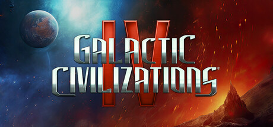

**Galactic Civilizations IV: Supernova is the latest entry featuring sector-based exploration, a new Commander unit system, and expanded civilization building with deeper cultural influence mechanics. Builds on three decades of 4X design refinement.**

---

## 📖 About

Galactic Civilizations IV: Supernova is the latest entry featuring sector-based exploration, a new Commander unit system, and expanded civilization building with deeper cultural influence mechanics. Builds on three decades of 4X design refinement.

## ⚠️ Problems Without Trainer

| Problem | Status |
|---------|--------|
| **Sector Navigation** — Multi-sector galaxy maps require managing fleets across different operational areas | ✅ Solved |
| **Citizen Management** — Assigning Commanders and Citizens to planets optimally requires practice | ✅ Solved |
| **Ideology System** — Commitments to law, chaos, or balance have cascading diplomatic consequences | ✅ Solved |
| **Crisis Events** — Galactic crisis events require rapid adaptation of long-term strategies | ✅ Solved |

## ✅ Solution

The **Galactic Civilizations IV Trainer** solves all these issues by giving you complete control over the game.

## 🎯 Full Feature List

- Unlimited Resources
- God Mode / Invincibility
- Instant Skill Cooldown
- One-Hit Kill
- Freeze Game Timer
- Unlock All Items & Achievements
- Custom Speed Multiplier
- Save State Anywhere

## 🚀 Quick Start

1. **Disable Windows Defender** temporarily (trainer may trigger false positive)
2. Download the trainer from the button above
3. Launch Galactic Civilizations IV
4. Run the trainer as Administrator
5. Activate desired cheats with hotkeys

## 💎 Free vs Paid

| Feature | Free | Pro |
|---------|------|-----|
| Basic God Mode | ✅ | ✅ |
| Unlimited Resources | ✅ | ✅ |
| All Advanced Cheats | ❌ | ✅ |
| Auto-Updates | ❌ | ✅ |
| Priority Support | ❌ | ✅ |

## 💻 Requirements

- Windows 10/11 (64-bit)
- Galactic Civilizations IV (any version)
- .NET Framework 4.8+
- DirectX 11+

## 🍎 macOS

macOS users can use our alternative tool:

## ⚖️ Legal

This trainer is for educational and single-player use only. Use responsibly.

---

